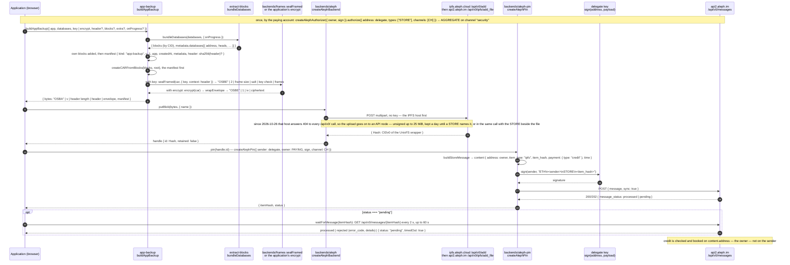
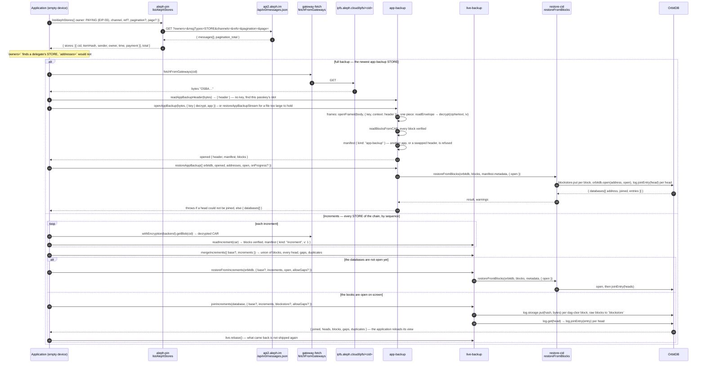

# An application's backup in one file

This is for an application whose state is several OrbitDB databases, perhaps with blocks of its own.
They go into one file, sealed with the application's key, kept on Aleph by a STORE that the browser
signs, and found again through the paying account. Two applications use it: Le-Space/belege and
Le-Space/invoice. Design and measurements: [#147](https://github.com/NiKrause/orbitdb-storage-bridge/issues/147).

## The file

```
"OSBA" | version (1) | header length (4 bytes, big-endian) | header | envelope
```

- **Header.** It belongs to the application and is read without a key, with `readAppBackupHeader`.
  It is room for a keyring, for example one sealed slot per passkey, so that any registered passkey
  finds the key to the rest. The package does not interpret it. The manifest inside the seal names
  the header's SHA-256, so `openAppBackup` refuses a header that was swapped later.
- **Envelope.** This is the package's `OSBE` envelope around the CAR, in one of two forms. The
  package keeps no keys in either.
  - **In frames** (version 2, with `key`): the CAR is sealed in frames of 1 MiB, each opened by
    itself, so a restore can open the file as it arrives and hold one frame. The header is bound
    into the key that seals the frames. This is the form to write; see [The envelope in frames](#the-envelope-in-frames).
  - **In one piece** (version 1, with the application's `encrypt`): one ciphertext under one IV.
    It can only be opened whole, with the sealed file and its plaintext in memory at once. Backups
    written with 0.28 and earlier are in this form and stay readable.
- **CAR root.** The root is a dag-cbor manifest:
  `{ kind: "app-backup", v: 1, app, createdAt, appVersion?, metadata, header?, extra? }`.
  - `metadata` is `bundleDatabases`'s: every database with its heads, and its `collection` when the
    databases were passed by name.
  - `extra` is the application's own, and must be something dag-cbor can encode (no `undefined`).
  - The manifest is the first block of the CAR, so a restore that reads the file as it arrives
    knows whose backup it is before it stores the rest.

### The envelope in frames

```
"OSBE" | 2 | frame size (4 bytes, big-endian) | salt (32) | key check (16) | frame 0 | frame 1 | … | last frame
```

- **A key per file.** `HKDF-SHA256(key, salt, info)`, with `info` = `"OSBE v2"` ‖ frame size ‖
  SHA-256(context). The application's key seals many files; the derived key seals one, so a counter
  is a nonce that cannot repeat under it. The context is the file's header: another header, and the
  file does not open.
- **Each frame** is AES-256-GCM over up to `frame size` bytes of plaintext, with a 16-byte tag.
  - Its nonce is its index (11 bytes, big-endian) and a mark: `0` for a frame with more behind it,
    `1` for the last frame, `2` for the key check.
  - Its additional data is the 41 bytes in front of the key check, the index (8 bytes) and the
    mark.
- **The key check** is the tag of an empty plaintext. A wrong key is known there, before any frame
  is opened; a frame that fails later is damage and never the key.
- **No lengths.** Every frame but the last is full. The reader cuts at the frame size and opens
  what is left at the end as the last frame.
- **What is refused, and where.** A frame left out, moved, repeated, altered or taken from another
  file fails at its index (`FrameError`, `reason: "frame"`, `frame`). So does a file cut short, at
  a frame's edge or inside one, and a file with anything appended: the frame it ends on was not
  sealed as the last.
- **What a reader may not assume.** Each chunk it is given is authentic and in its place, but the
  end is only known at the end. `restoreAppBackupStream` stores blocks as they arrive and joins
  the databases only after the last frame opened.

The key is 32 bytes, or a `CryptoKey` for HKDF. Frames cannot take the application's `encrypt`:
the nonce and the additional data are the format's to choose.

## Backing up from a browser

```js
import { buildAppBackup } from "@le-space/orbitdb-storage-bridge/app-backup";
import { createAlephBackend } from "@le-space/orbitdb-storage-bridge/backends/aleph";
import {
  createAlephPin,
  waitForMessage,
} from "@le-space/orbitdb-storage-bridge/backends/aleph-pin";

const { bytes } = await buildAppBackup({
  app: "invoice",
  databases: { invoices, settings }, // open OrbitDB databases, by name
  header: vault, // optional: read without a key
  key, // 32 bytes, or a CryptoKey for HKDF: sealed in frames
});

const { id } = await createAlephBackend().putBlob(bytes, {
  name: "invoice-2026-10-03.backup",
});
const pin = createAlephPin({
  sender: delegate.address,
  owner: PAYING_ACCOUNT,
  sign: delegate.sign,
  channel: "INVOICE-BACKUP",
});
const { itemHash, status } = await pin(id);
const kept =
  status === "processed" ? { status } : await waitForMessage(itemHash);
// kept.status: "processed", or "rejected" with Aleph's reason (for example, not enough credit)
```

- **The delegate.** It is a key the application holds. The paying account authorises it once:
  `createAlephAuthorizer({ owner, sign }).authorize({ address: delegate.address, types: ["STORE"], channels: ["INVOICE-BACKUP"], chain: "ETH" })`.
  From then on the browser signs alone, and the paying account does not have to be online.
- **Credit.** Aleph charges the paying account, not the delegate. The account needs credit for at
  least a day of the file. Prices are in [STORAGE-BACKENDS.md](STORAGE-BACKENDS.md), §6.
- **Memory.** A backup is built in memory and uploaded as one body, in either form. It is the
  restore that has to fit a phone.
- **Progress.** `buildAppBackup({ onProgress })` reports the bundle's stages and then `sealing`;
  `restoreAppBackup({ onProgress })` the restore's. `isAppBackup(bytes)` says whether bytes carry
  the `OSBA` magic, before anything is parsed.

### Step by step



## Finding it on an empty device

```js
import { listAlephStores } from "@le-space/orbitdb-storage-bridge/backends/aleph-pin";
import { fetchFromGateways } from "@le-space/orbitdb-storage-bridge/gateway-fetch";
import { readAppBackupHeader } from "@le-space/orbitdb-storage-bridge/app-backup";

const { stores } = await listAlephStores({
  owner: PAYING_ACCOUNT,
  channel: "INVOICE-BACKUP",
}); // newest first
const bytes = await fetchFromGateways(stores[0].cid);
const { header } = readAppBackupHeader(bytes); // e.g. find this passkey's slot, and the key in it
// A large file: `readAppBackupHeaderStream(source)` reads it from the first bytes,
// and `restoreAppBackupStream({ onHeader })` hands it over before anything is opened.
```

All the device needs is the paying account's public address.

`listAlephStores` pages: 50 per page by default (`pagination`, `page`), newest first within a page,
and `total` is the API's count — a long channel needs the next page before "newest" means anything.
`ref` narrows the listing to one chain ([LIVE-BACKUP.md](LIVE-BACKUP.md), "Several chains on one
account"). A STORE made with `size` (`pin.sign(cid, { size })`, or the signed upload through an API
node, which fills it) is listed with it: pass it on as `getBlob(handle, { size })` – or in the
handle – and a download that comes back short is refused at the gateway. A UnixFS CID is checked
by building the DAG again from the bytes (`matchesUnixfsCid`); a sealed file that came back
damaged would otherwise fail to open, which looks exactly like a wrong key.

### The restore, both shapes



## Restoring

As it arrives, for a backup sealed in frames. This is the way for a file of any size, and the only
one for a large file on a phone:

```js
import { restoreAppBackupStream } from "@le-space/orbitdb-storage-bridge/app-backup";
import { createAlephBackend } from "@le-space/orbitdb-storage-bridge/backends/aleph";

const onProgress = (p) => show(p); // fetched, opened, stored, database
await restoreAppBackupStream({
  orbitdb,
  source: createAlephBackend().getBlobStream(cid, {
    size, // the STORE's, when known: another length is refused
    onProgress: (received, total) => onProgress({ stage: "fetched", received, total }),
  }),
  onHeader: (header) => ({ key: keyFrom(header) }), // or pass `key`
  app: "invoice",
  addresses,
  open: { encryption, AccessController },
  onProgress,
});
```

- **Memory.** One chunk from the gateway, one frame, one block: about 11 MiB for a backup of
  100 MiB and the same for one of 20 MiB (`test/streamed-restore-memory.test.js`). In one piece the
  same 100 MiB take about 300 MiB.
- **The source** is any async iterable of bytes. `getBlobStream` picks a dropped connection up
  where it stopped (`Range`), and checks the file's size and its UnixFS CID at the end.
  `createGatewayFirstStream` (`/peer-fetch`) hands over to the peers at the byte the gateway
  stopped at.
- **The order of refusals.** A wrong key before the first frame. Another application's backup, or
  one of other books, at the manifest, which is the first block: nothing is stored. A damaged or
  shortened file at the frame, with its index: the databases are not opened. A blockstore that is
  full at the block it refused (`BlocksNotStoredError`).
- **What stays behind after a failure.** The blocks stored until then: sealed, content-addressed,
  pointed at by nothing.
- **A backup in one piece** is restored by the same call when `decrypt` is given, held whole
  because it cannot be opened otherwise (`streamed: false` in the result).
- **The pieces**, for an application with a manifest of its own: `openFrames`
  (`/backends/frames`), `storeBlocksFromCAR` and `restoreFromStoredBlocks` (`/restore-cid`).
  `storeBlocksFromCAR` takes several CARs into one result (`into`), as a base and its increments
  are several files; `mergeIncrements` merges their metadata without their blocks.

Whole, for a backup in either form that fits in memory:

```js
import {
  openAppBackup,
  restoreAppBackup,
} from "@le-space/orbitdb-storage-bridge/app-backup";

const opened = await openAppBackup(bytes, { key, decrypt, app: "invoice" });
await restoreAppBackup({
  orbitdb,
  opened,
  addresses,
  open: { encryption, AccessController },
});
```

- **What `openAppBackup` checks.** Every block is verified against its own CID. A wrong key fails
  at the key check (frames) or in `decrypt` itself (one piece). It also refuses a backup of another
  application, or one with a swapped header.
- **What `restoreAppBackup` does.** It merges and never replaces: what is here stays, and what the
  backup holds is added.
- **What `restoreAppBackup` refuses.** It puts nothing into books whose addresses do not match.
  A head that cannot be joined fails the restore, with the reason.
- **Afterwards.** The databases are reopened behind the application's back, so it reloads its
  handles.

## Replacing an old backup

A new backup does not remove the old one: each is a STORE the account pays for by the day. Once the
new STORE is `processed`, forget the rest, and only the rest:

```js
import {
  createAlephForget,
  forgetAlephStores,
} from "@le-space/orbitdb-storage-bridge/backends/aleph-pin";

const forget = createAlephForget({
  sender: delegate.address,
  owner: PAYING_ACCOUNT,
  sign: delegate.sign,
  channel: "INVOICE-BACKUP",
});
const { forgotten, kept, rejected, pending } = await forgetAlephStores({
  owner: PAYING_ACCOUNT,
  channel: "INVOICE-BACKUP",
  forget,
  keep: (store) => store.itemHash === newest.itemHash, // the one just confirmed
  reason: "replaced by a newer backup",
});
```

A delegate needs `FORGET` in its grant (`types: ["STORE", "FORGET"]`); otherwise the paying
account signs. `forgotten` is what Aleph confirmed, `pending` what it had not decided in time,
`kept` what `keep` spared — never forget without a `keep` that names the new backup. The
message flow and the semantics: [STORAGE-BACKENDS.md](STORAGE-BACKENDS.md#forgetting).
