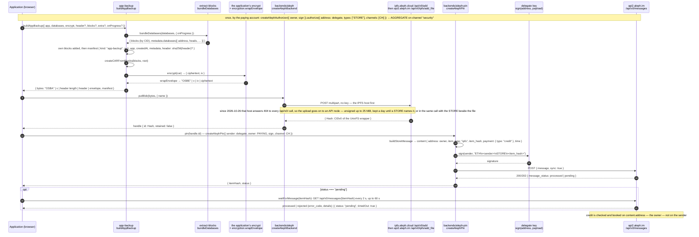
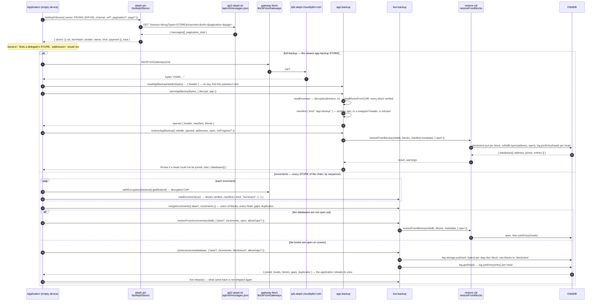

# An application's backup in one file

This is for an application whose state is several OrbitDB databases, perhaps with blocks of its own.
They go into one file, sealed with the application's key, kept on Aleph by a STORE that the browser
signs, and found again through the paying account. Two applications use it: Le-Space/belege and
Le-Space/invoice. Design and measurements: [#147](https://github.com/NiKrause/orbitdb-storage-bridge/issues/147).

## The file

```
"OSBA" | version (1) | header length (4 bytes, big-endian) | header | envelope
```

- **Header.** It belongs to the application and is read without a key, with `readAppBackupHeader`.
  It is room for a keyring, for example one sealed slot per passkey, so that any registered passkey
  finds the key to the rest. The package does not interpret it. The manifest inside the seal names
  the header's SHA-256, so `openAppBackup` refuses a header that was swapped later.
- **Envelope.** This is the package's `OSBE` envelope around the CAR, encrypted by the application's
  `encrypt`. The package holds no keys.
- **CAR root.** The root is a dag-cbor manifest:
  `{ kind: "app-backup", v: 1, app, createdAt, appVersion?, metadata, header?, extra? }`.
  - `metadata` is `bundleDatabases`'s: every database with its heads, and its `collection` when the
    databases were passed by name.
  - `extra` is the application's own, and must be something dag-cbor can encode (no `undefined`).

## Backing up from a browser

```js
import { buildAppBackup } from "@le-space/orbitdb-storage-bridge/app-backup";
import { createAlephBackend } from "@le-space/orbitdb-storage-bridge/backends/aleph";
import { createAlephPin, waitForMessage } from "@le-space/orbitdb-storage-bridge/backends/aleph-pin";

const { bytes } = await buildAppBackup({
  app: "invoice",
  databases: { invoices, settings }, // open OrbitDB databases, by name
  header: vault, // optional: read without a key
  encrypt, // (plaintext) => ({ ciphertext, iv }), with the application's key
});

const { id } = await createAlephBackend().putBlob(bytes, { name: "invoice-2026-10-03.backup" });
const pin = createAlephPin({ sender: delegate.address, owner: PAYING_ACCOUNT, sign: delegate.sign, channel: "INVOICE-BACKUP" });
const { itemHash, status } = await pin(id);
const kept = status === "processed" ? { status } : await waitForMessage(itemHash);
// kept.status: "processed", or "rejected" with Aleph's reason (for example, not enough credit)
```

- **The delegate.** It is a key the application holds. The paying account authorises it once:
  `createAlephAuthorizer({ owner, sign }).authorize({ address: delegate.address, types: ["STORE"], channels: ["INVOICE-BACKUP"], chain: "ETH" })`.
  From then on the browser signs alone, and the paying account does not have to be online.
- **Credit.** Aleph charges the paying account, not the delegate. The account needs credit for at
  least a day of the file. Prices are in [STORAGE-BACKENDS.md](STORAGE-BACKENDS.md), §6.
- **Progress.** `buildAppBackup({ onProgress })` reports the bundle's stages and then `sealing`;
  `restoreAppBackup({ onProgress })` the restore's. `isAppBackup(bytes)` says whether bytes carry
  the `OSBA` magic, before anything is parsed.

### Step by step




## Finding it on an empty device

```js
import { listAlephStores } from "@le-space/orbitdb-storage-bridge/backends/aleph-pin";
import { fetchFromGateways } from "@le-space/orbitdb-storage-bridge/gateway-fetch";
import { readAppBackupHeader } from "@le-space/orbitdb-storage-bridge/app-backup";

const { stores } = await listAlephStores({ owner: PAYING_ACCOUNT, channel: "INVOICE-BACKUP" }); // newest first
const bytes = await fetchFromGateways(stores[0].cid);
const { header } = readAppBackupHeader(bytes); // e.g. find this passkey's slot, and the key in it
```

All the device needs is the paying account's public address.

`listAlephStores` pages: 50 per page by default (`pagination`, `page`), newest first within a page,
and `total` is the API's count — a long channel needs the next page before "newest" means anything.
`ref` narrows the listing to one chain ([LIVE-BACKUP.md](LIVE-BACKUP.md), "Several chains on one
account").

### The restore, both shapes




## Restoring

```js
import { openAppBackup, restoreAppBackup } from "@le-space/orbitdb-storage-bridge/app-backup";

const opened = await openAppBackup(bytes, { decrypt, app: "invoice" });
await restoreAppBackup({ orbitdb, opened, addresses, open: { encryption, AccessController } });
```

- **What `openAppBackup` checks.** Every block is verified against its own CID. A wrong key fails in
  `decrypt` itself. It also refuses a backup of another application, or one with a swapped header.
- **What `restoreAppBackup` does.** It merges and never replaces: what is here stays, and what the
  backup holds is added.
- **What `restoreAppBackup` refuses.** It puts nothing into books whose addresses do not match.
  A head that cannot be joined fails the restore, with the reason.
- **Afterwards.** The databases are reopened behind the application's back, so it reloads its
  handles.

## Replacing an old backup

A new backup does not remove the old one: each is a STORE the account pays for by the day. Once the
new STORE is `processed`, forget the rest, and only the rest:

```js
import { createAlephForget, forgetAlephStores } from "@le-space/orbitdb-storage-bridge/backends/aleph-pin";

const forget = createAlephForget({ sender: delegate.address, owner: PAYING_ACCOUNT, sign: delegate.sign, channel: "INVOICE-BACKUP" });
const { forgotten, kept, rejected, pending } = await forgetAlephStores({
  owner: PAYING_ACCOUNT,
  channel: "INVOICE-BACKUP",
  forget,
  keep: (store) => store.itemHash === newest.itemHash, // the one just confirmed
  reason: "replaced by a newer backup",
});
```

A delegate needs `FORGET` in its grant (`types: ["STORE", "FORGET"]`); otherwise the paying
account signs. `forgotten` is what Aleph confirmed, `pending` what it had not decided in time,
`kept` what `keep` spared — never forget without a `keep` that names the new backup. The
message flow and the semantics: [STORAGE-BACKENDS.md](STORAGE-BACKENDS.md#forgetting).
