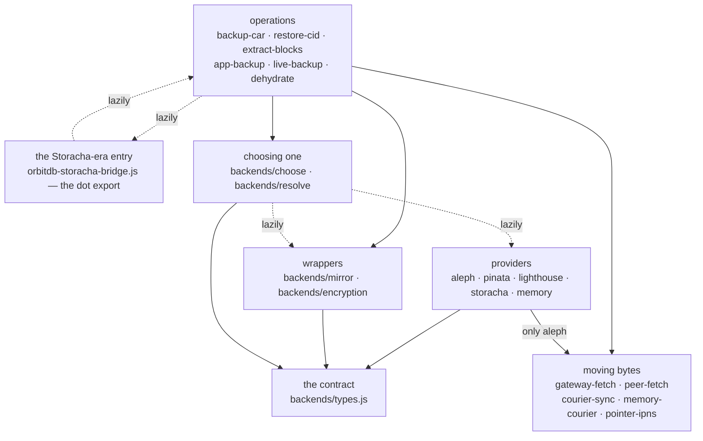

# Architecture: the package from the inside

The README's [Entry points](../README.md#entry-points) table says what each import is *for*,
and [DESIGN.md](DESIGN.md) says what a backup and a restore *do*. Neither says how the files
under `lib/` stand to one another, which is the thing you need before you move one.

So: 33 modules, 14 271 lines, 48 edges between them. The graph is shallow — ten modules
import nothing of ours at all — and it is held in shape by three rules that are worth knowing
before adding the thirty-fourth. Measured on 2026-10-29 by scanning the imports; the last
section says how to run that scan again, because a drawing nobody can re-derive goes stale
quietly.

## The shape



Dotted edges are `await import(...)`: real dependencies that a bundler is free to split off,
and the reason two of them may point backwards.

## The layers, and what each may import

| layer | modules | may import |
| --- | --- | --- |
| the contract | `backends/types.js` (193 lines) | nothing |
| providers | `aleph` 322, `pinata` 330, `lighthouse` 325, `storacha` 181, `memory` 140, plus the Aleph helpers `aleph-pin` 887 and `aleph-upload` 243, and the Storacha loader `storacha-client` 36 | the contract, and for `aleph` the gateway reader |
| wrappers | `mirror` 234 (write to several), `encryption` 284 (the service holds ciphertext) | the contract |
| choosing one | `choose` 186, `resolve` 82 | the contract, and every driver — late |
| moving bytes | `gateway-fetch` 243, `peer-fetch` 391, `courier-sync` 1312, `memory-courier` 105, `pointer-ipns` 234 | nothing of ours, bar the logger |
| operations | `backup-car` 1291, `restore-cid` 578, `extract-blocks` 331, `app-backup` 300, `live-backup` 865, `dehydrate` 188 | everything below |
| the old entry | `orbitdb-storacha-bridge.js` 2793 | everything below, and `backup-car` late |
| cross-cutting | `logger` 128, `utils` 316, and the small shared pieces `backup-helpers` 87, `backup-metadata` 40, `block-bytes` 39 | nothing above them |

`logger.js` is the most-imported file in the package — twelve modules take it — and
`backends/types.js` is next with ten. Those two are the only hubs; everything else is used
once or twice.

## Rule 1: nothing outside `backends/` names a provider

No module in `lib/` outside the `backends/` directory imports `aleph`, `pinata`,
`lighthouse`, `storacha`, `memory` or `mirror`. An operation that needs somewhere to put
bytes takes a backend as an argument, or asks `backends/resolve` for one. The check is a
grep, and it is meant to stay one:

```sh
grep -rnE 'from "\./backends/(aleph|pinata|lighthouse|storacha|memory|mirror)' lib/*.js
```

The deliberate exception is `backends/encryption`, which `app-backup` and `dehydrate` import
directly — it is not a provider but a decorator over whichever one it is handed, so naming it
commits to nothing.

## Rule 2: `@storacha/client` is never imported statically

It has been an optional peer since 0.22.0. Vite and Rollup follow a dynamic import into a
chunk and resolve its *named* imports at build time, so a single static
`import { Signer } from "@storacha/client/…"` anywhere reachable breaks the build of an
application that never chose Storacha — even inside a driver that is only ever `import()`ed.
Le-Space/belege found that on 0.22.0.

`lib/storacha-client.js` is the one module allowed to reach for it, and it does so
dynamically. [`test/no-static-storacha-import.test.js`](../test/no-static-storacha-import.test.js)
asserts both halves on every run, with one name on its allow-list — see rule 3.

## Rule 3: what is loaded late, and why

| from | loads | why |
| --- | --- | --- |
| `backends/choose` | every provider, and `mirror` | a page bundles the one its reader picked, not all five |
| `backends/resolve` | `choose`, `storacha` | the same, for the older options-shaped API |
| `dehydrate` | `backup-car`, `restore-cid`, `encryption`, `gateway-fetch` | a page that only *publishes a pointer* pays for neither half |
| `backup-car` | `orbitdb-storacha-bridge` | the space-side helpers live in the old entry, which pulls in ~88 kB gzipped of Storacha client |
| `orbitdb-storacha-bridge` | `backup-car` | the edge back, which would otherwise close a cycle |

Those last two are a genuine cycle, and it does not bite only because both directions are
deferred. Both ends say so in a comment; if you ever make either static, the other has to
move first.

## The modules nothing under `lib/` imports

`car-storage.js` (342), `ipns-helpers.js` (324) and `ucan-bridge.js` (921) are reachable only
from tests and from the Storacha-era scripts in `examples/storacha/`. None of the three is in
the package's `exports`, so no consumer can import them at all. `ucan-bridge.js` is also the
one name on the static-import allow-list above: it is Storacha-era, imported by nothing here,
and may keep its static imports until it goes. Together they are 1 587 lines — a ninth of
`lib/` — carried for scripts that cannot run against a service that was decommissioned in
2026 ([STORACHA-SUNSET.md](STORACHA-SUNSET.md)).

## Where a new thing goes

- **Another storage service.** One file in `lib/backends/`, importing `backends/types.js` and
  nothing else of ours; a lazy branch in `backends/choose.js`; a row in the capability table
  in [STORAGE-BACKENDS.md](STORAGE-BACKENDS.md). The shared
  [`test/backends/conformance.test.js`](../test/backends/conformance.test.js) then checks the
  driver against the contract it declares, including that a CAR survives byte for byte.
- **Another way to move bytes.** Beside `gateway-fetch` and `peer-fetch`, importing nothing of
  ours bar the logger, so it can be handed to a restore as a `fetchBytes` without dragging a layer with it.
- **Another operation.** Beside `restore-cid`: take the backend as an argument, reach the
  providers only through `resolve`, and keep the heavy halves behind `await import(...)` if a
  caller might not need them.

## How to re-derive this

```sh
python3 - <<'PY'
import pathlib, re
for f in sorted(pathlib.Path("lib").rglob("*.js")):
    txt = f.read_text()
    code = re.sub(r"/\*.*?\*/", "", txt, flags=re.S)       # JSDoc's import() is a type, not an edge
    code = re.sub(r"(?m)//.*$", "", code)
    static = sorted(set(re.findall(r'from\s+"(\.[^"]+)"', code)))
    lazy = sorted(set(re.findall(r'import\(\s*"(\.[^"]+)"', code)))
    print(f"{str(f)[4:]:28} {', '.join(static) or '—'}" + (f"   [late: {', '.join(lazy)}]" if lazy else ""))
PY
```

Strip the comments first or you will count JSDoc: most of the `import("./types.js")`
occurrences in `lib/backends/` are `@param` annotations, not edges.
